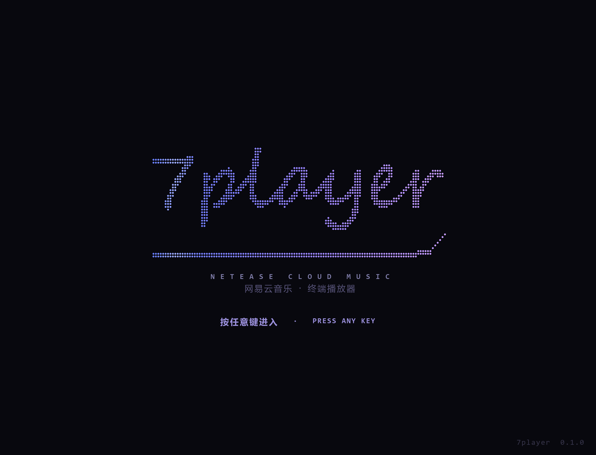
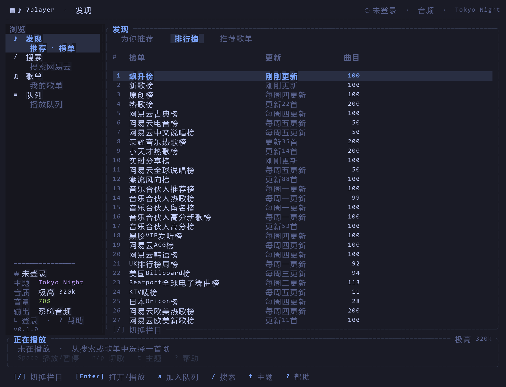
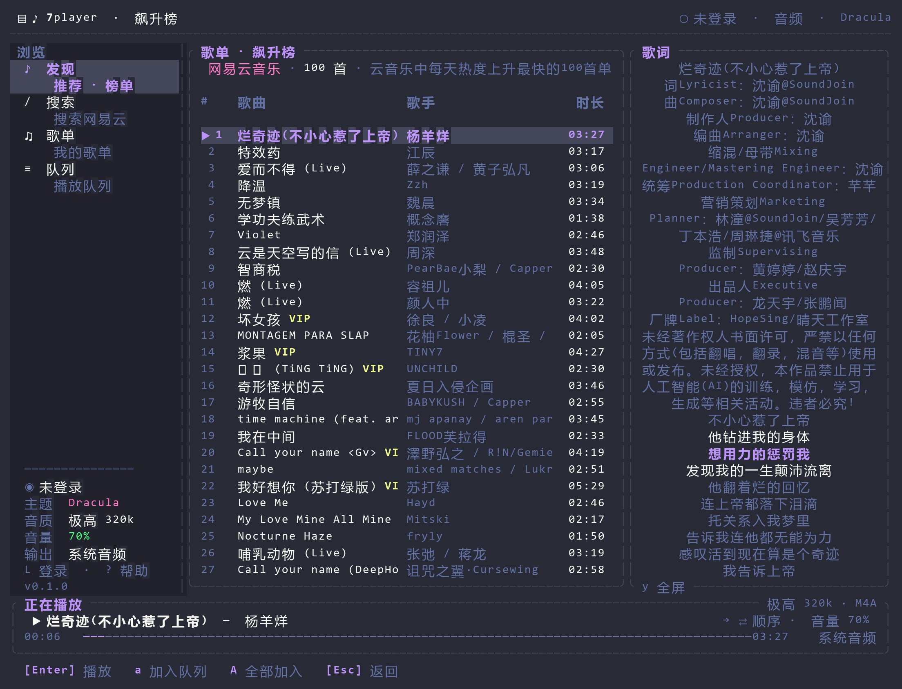
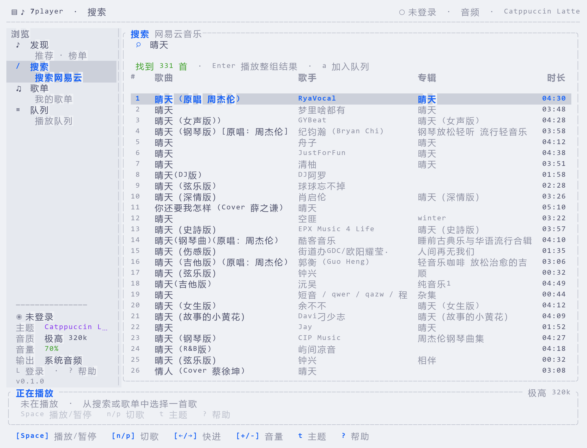
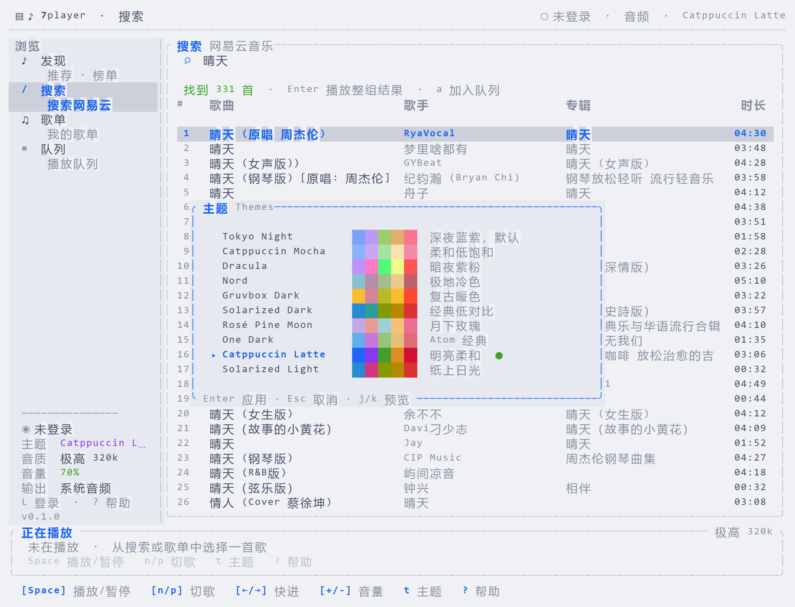
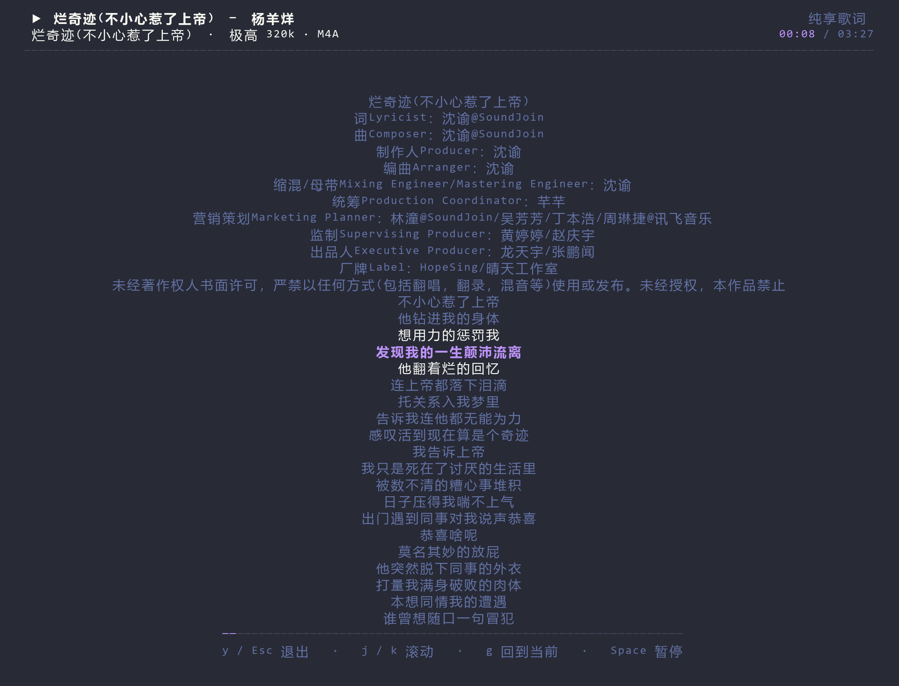

# 7player

[](https://github.com/7unar/7player/actions/workflows/ci.yml)
[](https://github.com/7unar/7player/releases)
[](LICENSE)
[](https://www.rust-lang.org/)
[](#安装)

一个用 Rust 写的网易云音乐终端播放器。基于 **Ratatui + Crossterm** 构建界面，使用 **Rodio** 解码播放，在 Linux / WSL 中运行；支持网易云扫码登录、手机号登录、搜索、排行榜、歌单、每日推荐、歌词同步、纯享歌词和 10 套主题。

A NetEase Cloud Music TUI player for Linux and WSL, written in Rust.

[安装](#安装) · [运行](#运行) · [按键](docs/KEYBINDINGS.md) · [配置](#配置与数据) · [架构](docs/ARCHITECTURE.md) · [更新日志](CHANGELOG.md) · [贡献](CONTRIBUTING.md)

> **Status:** `v0.1.0`，早期版本，API 可能随 NetEase 服务变化。
> 非官方客户端，仅供学习与研究使用。请使用自己的账号，尊重版权，不要用于绕过付费/地区限制。

## 预览



| Tokyo Night · 发现 | Dracula · 播放与歌词 |
| --- | --- |
|  |  |
| **Catppuccin Latte · 搜索** | **扫码登录** |
|  |  |

主题切换器内置 10 套配色，`t` 打开后可实时预览：



播放中按 `y` 进入纯享歌词模式：顶栏、侧栏、播放栏全部隐藏，只保留歌词、进度和快捷键提示。



## 功能

- **7player 品牌**
  - 启动时显示手写签名风格的 `7player`（Braille 点阵），逐点书写 + 下划线收笔，60fps
  - 按任意键或鼠标点击跳过，2.8 秒后自动进入
  - `--no-splash` 可跳过动画，适合脚本/截图
  - 旧 `ncm-tui` 的配置、Cookie 和音频缓存会自动迁移到 `7player` 目录
- **网易云登录**
  - 二维码扫码登录（推荐，最稳定）
  - 手机号 + 密码登录（部分账号会触发风控/验证码，错误会显示在面板内）
  - Cookie 持久化到 `~/.config/7player/cookies.json`，文件权限 `0600`
  - `Ctrl+L` 退出登录并清除本地登录态
- **浏览**
  - 公开排行榜（飙升榜、热歌榜、新歌榜等 60+ 榜单）
  - 搜索歌曲（歌名/歌手/专辑，单次最多 50 首）
  - 登录后同步每日推荐、推荐歌单、我的歌单、红心收藏
  - 歌单详情与整队列播放
- **播放**
  - Rodio 解码 MP3 / FLAC / AAC / M4A / OGG / WAV
  - 播放/暂停、上一首/下一首、进度跳转、音量、静音
  - 顺序 / 列表循环 / 单曲循环 / 随机播放
  - 播放队列：加入单曲、全部加入、移除、跳播
  - 音频缓存到 `~/.cache/7player/audio/`，重复播放不再下载
  - 无音频设备时自动切换“静音模拟”，界面和歌词仍然可用
- **歌词**
  - LRC 时间轴同步，支持翻译歌词
  - 宽屏右侧歌词栏；`y` 进入纯享歌词模式（隐藏顶栏、侧栏、播放栏）
  - `j/k` 手动滚动，`g` 回到当前行
- **外观**
  - 10 套内置主题：Tokyo Night、Catppuccin Mocha/Latte、Dracula、Nord、Gruvbox Dark、Solarized Dark/Light、Rosé Pine Moon、One Dark
  - `t` 主题选择器实时预览，Enter 应用并写入配置
  - `b` 或点击顶栏 `▤` 折叠侧边栏，状态持久化
  - 主题、音量、音质、侧边栏均持久化
- **交互**
  - Vim 风格键位：`j/k` 上下、`h/l` 切页、`gg/G` 首尾、`Ctrl+d/u` 半页、`0/$`、`/` 搜索
  - 鼠标点击导航、歌曲、播放/暂停、进度条、音量、主题、登录标签
  - 滚轮滚动列表、调音量、滚动歌词
- **工程**
  - 异步网络任务 + 独立音频线程，UI 不阻塞
  - 自带 `--check` 联网自检；无需进入 TUI 即可验证 API 是否可用
  - 44 个单元测试，覆盖加密、Cookie、LRC、数据模型、队列、主题、按键解析和配置

## 安装

### 一键安装（推荐）

需要 Linux x86_64、`curl` 和 `tar`：

```bash
curl -fsSLO https://raw.githubusercontent.com/7unar/7player/main/install.sh
bash install.sh
```

默认安装到 `~/.local/bin/7player`。安装到系统路径或指定版本：

```bash
sudo env PREFIX=/usr/local bash install.sh
VERSION=0.1.0 bash install.sh
```

安装脚本会从 GitHub Releases 下载二进制并校验 SHA-256。

### Release 压缩包

预编译包目前只提供 **x86_64**，在 Ubuntu 22.04（glibc 2.35+）上构建；aarch64 或更老的发行版请从源码构建。

从 [Releases](https://github.com/7unar/7player/releases/latest) 下载
`7player-x86_64-unknown-linux-gnu.tar.gz`，然后：

```bash
tar -xzf 7player-x86_64-unknown-linux-gnu.tar.gz
sudo install -Dm755 7player /usr/local/bin/7player
7player --version
```

### Cargo 安装

```bash
cargo install --git https://github.com/7unar/7player.git --locked --bin 7player
7player
```

### 从源码构建

```bash
git clone https://github.com/7unar/7player.git
cd 7player
cargo build --release
./target/release/7player
```

构建依赖：

- Rust stable ≥ 1.82（推荐 [rustup](https://rustup.rs/)）
- ALSA 开发库
  - Arch: `sudo pacman -S --needed base-devel pkgconf alsa-lib`
  - Debian/Ubuntu: `sudo apt install build-essential pkg-config libasound2-dev`
  - Fedora: `sudo dnf install gcc pkgconf-pkg-config alsa-lib-devel`
- 可用的终端，建议 **120×40**，最低约 **100×30**
- 支持中文和常用符号的等宽字体（Windows Terminal 的 Cascadia Code + 微软雅黑回退即可）

项目使用 `rustls`，不依赖 OpenSSL。

## 运行

```bash
7player
```

```bash
# 指定启动主题
7player --theme tokyo-night

# 无音频设备 / CI / 纯 SSH：静音模拟
7player --no-audio

# 跳过启动签名动画
7player --no-splash

# 联网自检：匿名会话、排行榜、搜索、音源、歌词、歌单
7player --check

# 查看版本与全部主题名
7player --help
```

`--theme` 可选值：

```text
tokyo-night, catppuccin-mocha, dracula, nord, gruvbox-dark,
solarized-dark, rose-pine, one-dark, catppuccin-latte, solarized-light
```

### WSL 音频

WSL2 **没有原生声卡**。声音链路是：

```text
7player → ALSA(pulse 插件) → WSLg PulseAudio(RDPSink) → Windows 默认输出设备
```

WSLg 会提供 `PULSE_SERVER=unix:/mnt/wslg/PulseServer`，但 Arch WSL 的 ALSA 默认设备不会自动指向它。当前版本会自动检测 WSLg，并在 `~/.cache/7player/asound-pulse.conf` 生成：

```text
pcm.!default { type pulse }
ctl.!default { type pulse }
```

你只需要确保装了 ALSA 的 Pulse 插件：

```bash
sudo pacman -S --needed alsa-plugins
```

然后直接启动即可，不需要手写 `~/.asoundrc`：

```bash
./target/release/7player
```

如果你更喜欢手动配置，也可以：

```bash
cat > ~/.asoundrc <<'EOF'
pcm.!default { type pulse }
ctl.!default { type pulse }
EOF
```

或者临时指定：

```bash
ALSA_CONFIG_PATH=/tmp/7player-asound.conf ./target/release/7player
```

注意：如果程序显示“静音模拟”，说明 ALSA 没有成功打开 Pulse 设备；`pactl list short sinks` 应能看到 `RDPSink`。如果显示“系统音频”但仍没有声音，问题通常在 **Windows 的默认输出设备或音量**，而不是 WSL 内部——WSLg 只是把音频转发给 Windows 当前默认播放设备。

## 登录

1. 按 `L` 打开登录面板。
2. 默认是二维码登录：用网易云音乐 App 扫码，并在手机上确认。
3. 或按 `Tab` 切到“手机号登录”，输入手机号和密码后回车。
4. 登录成功后自动同步用户资料、每日推荐、歌单和红心。

说明：

- 扫码登录比密码登录稳定；手机号密码登录在新设备上可能返回 `-462`（风控）或要求验证码。
- 登录态只保存在本机 Cookie 文件中，权限为 `0600`；请勿把该文件提交到仓库或发给他人。
- 登录失败时会保留面板并显示接口错误；二维码过期按 `r` 刷新。
- 未登录也可以听公开榜单、搜索和播放有版权许可的歌曲。

## 快捷键

> 采用 Vim 风格导航：`j/k` 上下、`h/l` 左右切换页面、`gg/G` 首尾、`Ctrl+d/u` 半页、`/` 搜索、`0/$` 首尾。因为 `l` 用于横向导航，纯享歌词改为 `y`。

### 全局

| 按键 | 功能 |
| --- | --- |
| `q` | 退出（输入框聚焦时输入 q） |
| `Ctrl+C` | 强制退出 |
| `Space` | 播放 / 暂停 |
| `n` / `p` | 下一首 / 上一首 |
| `←` / `→` | 快退 / 快进 5 秒 |
| `+` / `-` | 音量 ±5% |
| `m` | 静音 / 恢复 |
| `s` | 随机播放开关 |
| `r` | 循环模式：不循环 → 列表循环 → 单曲循环 |
| `f` | 播放队列 |
| `y` | 纯享歌词模式 |
| `b` | 显示 / 隐藏侧边栏 |
| `z` | 喜欢 / 取消喜欢当前歌曲（需登录） |
| `a` / `A` | 当前歌曲加入队列 / 当前列表全部加入 |
| `/` 或 `i` | 打开搜索并聚焦输入框 |
| `h` / `l` | 上一个 / 下一个页面（Vim 横向切换） |
| `1` `2` `3` `4` | 发现 / 搜索 / 歌单 / 队列 |
| `Tab` / `Shift+Tab` | 循环切换页面 |
| `t` | 主题选择器（实时预览） |
| `L` | 登录（已登录时显示账号） |
| `Ctrl+L` | 退出登录 |
| `R` | 刷新当前页面 |
| `?` | 快捷键帮助 |
| `Esc` | 返回上一层 / 关闭弹窗 |

### 列表与页面

| 场景 | 按键 | 功能 |
| --- | --- | --- |
| 所有列表 | `j/k` 或 `↑/↓` | 上下移动 |
| 所有列表 | `gg/G` 或 `Home/End` | 跳到首 / 尾 |
| 所有列表 | `Ctrl+d/u` | 向下 / 向上半页（10 行） |
| 所有列表 | `Ctrl+f/b` | 向下 / 向上翻页（20 行） |
| 所有列表 | `0/$` | 跳到首 / 尾 |
| 所有列表 | `PageUp/PageDown` | 翻 10 行 |
| 发现 | `[` / `]` | 切换“为你推荐 / 排行榜 / 推荐歌单” |
| 发现 / 搜索 / 歌单 | `Enter` | 播放整组结果 / 打开歌单 |
| 歌单详情 | `a` / `A` | 加入当前歌曲 / 全部加入队列 |
| 队列 | `Enter` | 播放选中项 |
| 队列 | `d` | 从队列移除选中项 |
| 搜索框 | `Enter` | 执行搜索 |
| 搜索框 | `Esc` | 返回结果列表 |
| 搜索框 | `Ctrl+U` | 清空输入 |
| 歌词页 | `j/k` | 滚动歌词 |
| 歌词页 | `g` | 回到当前播放行 |

### 自定义按键

普通界面的按键可以通过 `~/.config/7player/config.toml` 的 `[keys]` 覆盖，不需要重新编译：

```toml
[keys]
quit = "Q"
search = ["/", "ctrl+p"]
move_up = ["k", "up"]
top = ["g g", "home"]
help = []          # 禁用 ?
```

- 值是字符串或字符串数组；数组表示同一动作的多个替代键
- 多键序列用空格分隔，例如 `g g`
- `[]` 或 `"none"` 可以禁用某个动作
- 覆盖是整组替换，不是追加；例如覆盖 `move_up` 后默认的 `k`/`↑` 会失效
- 未知动作和非法按键会被忽略，并在启动时提示；出错的动作保留默认绑定

动作 ID、特殊键名和完整默认表见
[docs/KEYBINDINGS.md](docs/KEYBINDINGS.md)。

## 鼠标操作

程序启动时开启终端鼠标捕获，大部分常用操作都可以直接点：

| 位置 | 单击行为 |
| --- | --- |
| 左侧导航 | 切换页面 |
| 发现页栏目 | 切换“为你推荐 / 排行榜 / 推荐歌单” |
| 歌曲 / 歌单行 | 选中并播放 / 打开 |
| 播放栏 `▶/⏸` | 播放 / 暂停 |
| 播放栏歌名 | 打开纯享歌词 |
| 播放栏进度条 | 跳转到点击位置 |
| 播放栏右下角音量 | 静音 / 恢复 |
| 右侧歌词栏 | 打开纯享歌词 |
| 顶栏 `▤` | 显示 / 隐藏侧边栏 |
| 主题选择器行 | 应用该主题并关闭 |
| 登录面板的二维码/手机号标签 | 切换登录方式 |
| 登录面板手机号、密码 | 聚焦输入框 |
| 手机号登录的提示行 | 提交登录 |

鼠标滚轮：

- 在歌曲/歌单列表上：上下滚动选中项（3 行）
- 在播放栏上：调音量
- 在歌词栏/歌词页上：滚动歌词

> 鼠标捕获开启后，普通拖拽不会选中文本；需要复制歌曲名时按住 **Shift** 再拖动。

## 主题

按 `t` 打开主题选择器，`j/k` 预览，`Enter` 应用，`Esc` 取消。主题名会写入配置文件，并在下次启动时恢复。

| 名称 | 风格 |
| --- | --- |
| `tokyo-night` | 深夜蓝紫（默认） |
| `catppuccin-mocha` | 柔和低饱和 |
| `dracula` | 暗夜紫粉 |
| `nord` | 极地冷色 |
| `gruvbox-dark` | 复古暖色 |
| `solarized-dark` | 经典低对比 |
| `rose-pine` | 月下玫瑰 |
| `one-dark` | Atom 经典 |
| `catppuccin-latte` | 明亮柔和（浅色） |
| `solarized-light` | 纸上日光（浅色） |

## 配置与数据

| 路径 | 内容 |
| --- | --- |
| `~/.config/7player/config.toml` | 主题、音量、音质、侧边栏状态 |
| `~/.config/7player/cookies.json` | 登录 Cookie（`0600`，勿分享） |
| `~/.cache/7player/audio/` | 下载的音频缓存，可安全删除 |
| `~/.cache/7player/7player.log` | 少量内部错误日志 |

`config.toml` 示例：

```toml
theme = "tokyo-night"
volume = 70
quality = "exhigh" # standard / higher / exhigh / lossless
sidebar = true     # false 时启动即隐藏侧边栏
# [keys] 另见 docs/KEYBINDINGS.md
```

> 音质为 `lossless` 时，若账号没有对应权限，播放可能失败；可以改回 `exhigh` 或 `standard`。程序会把实际拿到的码率显示在播放栏右上角。

## 项目结构

```text
src/
├── main.rs              # CLI、终端生命周期、--check
├── app.rs               # 应用状态机、Action 执行、播放队列、登录流程
├── audio.rs             # Rodio 音频线程 + 静音模拟 + seek/音量
├── config.rs            # 配置、路径与 [keys] 覆盖
├── keymap.rs            # KeyChord → Action，默认键位与用户覆盖
├── worker.rs            # 异步网络任务与 Msg
├── netease/
│   ├── mod.rs           # NetEase 客户端与接口
│   ├── crypto.rs        # weapi(AES-CBC+RSA) / eapi(AES-ECB+MD5)
│   ├── cookie.rs        # Cookie 持久化、设备指纹、Set-Cookie 解析
│   ├── model.rs         # 歌曲/歌单/用户/URL/二维码模型
│   └── lrc.rs           # LRC 时间轴与翻译合并
└── ui/
    ├── mod.rs           # 布局、视图、弹窗、播放栏
    └── theme.rs         # 10 套主题调色板
tools/
└── ansi2png.py          # 把 tmux ANSI 截图渲染为 PNG
```

更详细的设计说明见 [docs/ARCHITECTURE.md](docs/ARCHITECTURE.md)。

### 数据流（简图）

```text
键盘事件 ──► App::on_key ──► 修改状态 / 发送命令
                                  │
        ┌─────────────────────────┼────────────────────────┐
        ▼                         ▼                        ▼
  Tokio 网络任务            音频线程(rodio)           配置文件/Cookie
  搜索/歌单/URL/歌词        播放/暂停/seek/音量        theme/volume/cookies
        │                         │
        └──────── Msg ────────────┴──► App::on_msg ──► UI
```

## 开发与测试

```bash
cargo fmt --check
cargo clippy --all-targets -- -D warnings
cargo test
cargo run -- --check
```

联网自检会：

1. 注册匿名设备会话；
2. 查询登录状态；
3. 拉取公开排行榜；
4. 搜索“周杰伦”；
5. 取第一首歌的播放地址；
6. 取歌词；
7. 取第一个榜单的详情。

开发辅助示例：

```bash
# 音频后端冒烟测试（需先生成一段测试音频）
ffmpeg -f lavfi -i "sine=frequency=440:duration=3" -codec:a libmp3lame /tmp/7player-tone.mp3
cargo run --example audio_probe /tmp/7player-tone.mp3

# 只测 API
cargo run --example api_probe
```

### 截图

`tools/ansi2png.py` 把 `tmux capture-pane -e` 的 ANSI 输出渲染成 PNG，使用系统中的 Consolas / 微软雅黑字体（路径可按需修改）：

```bash
tmux new-session -d -s 7player -x 120 -y 40 './target/release/7player'
tmux set -g default-terminal 'tmux-256color'
tmux set -as terminal-features ',*:RGB'
tmux capture-pane -e -p -t 7player > /tmp/shot.ansi
python3 tools/ansi2png.py /tmp/shot.ansi screenshots/shot.png \
  --theme tokyo-night --cols 120 --rows 40 --scale 2 --font-size 14
```

## 常见问题

### 启动时满屏 `ALSA lib ...`，界面花屏/错位

这是 ALSA 在音频设备探测失败时直接写 stderr 导致的。TUI 使用 alternate screen，任何绕过 ratatui 的 stderr 输出都会覆盖界面。当前版本已经修复：音频探测期间临时把 stderr 重定向到 `/dev/null`，失败时只显示一条“静音模拟”提示。

请确认使用的是最新构建：

```bash
cd 7player
cargo build --release
./target/release/7player
```

如果不想排查音频，直接：

```bash
./target/release/7player --no-audio
```

### 没有声音

按顺序排查：

1. **看程序左下角“输出”**
   - `静音模拟`：ALSA 没打开 WSLg Pulse。安装 `alsa-plugins`，重新启动；程序会自动生成 `~/.cache/7player/asound-pulse.conf`。
   - `系统音频`：WSL 侧已把音频送到 Pulse，问题在 Windows 输出。
2. **看播放栏音量**  
   如果显示 `音量 0%`，按 `m` 或 `+` 恢复；音量会持久化，上一次静音退出后下次启动仍是 0。
3. **看 WSL 的 Pulse sink**

   ```bash
   pactl list short sinks
   pactl get-sink-mute @DEFAULT_SINK@
   pactl get-sink-volume @DEFAULT_SINK@
   ```

   正常应该有 `RDPSink`，Mute 为 `no`，Volume 为 100%。
4. **看 Windows 默认输出设备**  
   WSLg 只是把声音转发给 **Windows 当前默认播放设备**。机器上有 Realtek、USB Audio、NVIDIA HDMI、ToDesk Virtual Audio、Steam Streaming Speakers 等多个端点，如果默认选到了虚拟设备/没有扬声器的 HDMI，就会出现“WSL 有音频流但听不到”。
   - 点任务栏音量图标，把输出切到真实扬声器/耳机。
   - 打开“音量合成器”，确认 WSL / `msrdc` / `Windows Subsystem for Linux` 没有被静音或调到 0。
   - 关闭 ToDesk/Steam 串流等虚拟声卡，或把默认设备切回 Realtek/USB。
5. **重启 WSL 音频**  
   在 PowerShell 执行 `wsl --shutdown`，重新打开 WSL 后再启动播放器。

仍然无声可以先用 `--no-audio` 确认界面和歌词正常；这只是关闭声音，不影响其他功能。

### 二维码显示不全 / 弹窗被裁切

终端太小。二维码需要至少约 **100×30**；建议 **120×40**。窗口不足时程序会显示紧凑提示，按 `Tab` 可先用手机号登录。

### 颜色发灰、背景透出桌面

Windows Terminal 的“不透明度 / 亚克力 / 背景图片”会让主题颜色变淡。把该配置的不透明度设为 100%、关闭背景图片，Tokyo Night 的深色背景才会完整显示。

## 已知限制

- 非官方 API：接口随时可能变化；登录风控、版权、地区限制都可能导致某些歌曲无音源。
- 不绕过 VIP / 付费 / 版权限制；只播放账号有权访问且接口返回的 URL。
- 搜索结果最多 50 首，歌单最多 1000 首；暂未实现分页加载。
- 手机号登录只支持密码方式；遇到验证码/风控请改用扫码。
- 歌词为逐行同步，不是逐字卡拉 OK；翻译只显示当前行。
- 播放前会把整首歌下载到缓存再播放（便于 seek），因此首播有几秒等待。
- 无封面图；TUI 中不显示专辑封面。
- 音频仅支持 Rodio/Symphonia 能解码的格式；VIP 无损是否可用取决于账号与接口。
- 终端建议至少 100×30；80×24 下部分弹窗会被裁切。

## 文档

- [按键配置与完整默认键位](docs/KEYBINDINGS.md)
- [架构与数据流](docs/ARCHITECTURE.md)
- [更新日志](CHANGELOG.md)
- [安全策略](SECURITY.md)

## 贡献

欢迎提交 Issue 和 PR。开始之前请先阅读 [CONTRIBUTING.md](CONTRIBUTING.md)；
涉及安全问题时请不要公开 Issue，按 [SECURITY.md](SECURITY.md) 私下报告。

```bash
cargo fmt --check
cargo clippy --all-targets -- -D warnings
cargo test
```

## 参考与致谢

- [pigma](https://github.com/akirco/pigma)：Rust + Ratatui 的网易云 TUI，本项目在交互与 weapi/eapi 协议实现上参考了它（Apache-2.0，见 [NOTICE](NOTICE)）。
- [go-musicfox](https://github.com/go-musicfox/go-musicfox)：Go 版网易云 TUI，参考了导航、播放队列和登录体验。
- [NeteaseCloudMusicApi](https://github.com/Binaryify/NeteaseCloudMusicApi)：社区维护的接口文档与实现。
- [Ratatui](https://ratatui.rs/)、[Crossterm](https://github.com/crossterm-rs/crossterm)、[Rodio](https://github.com/RustAudio/rodio)、[qrcode](https://github.com/kennytm/qrcode-rust)。

## License

本项目代码以 [MIT](LICENSE) 授权。`src/netease/crypto.rs` 中参考 pigma 的协议实现遵循 Apache-2.0，其许可证全文见 [LICENSES/Apache-2.0.txt](LICENSES/Apache-2.0.txt)，归属声明见 [NOTICE](NOTICE)。

---

如果这个项目对你有帮助，欢迎点个 Star；也欢迎提交 Issue / PR（尤其是新主题、更多接口和登录方式）。
